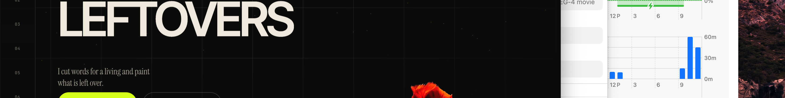
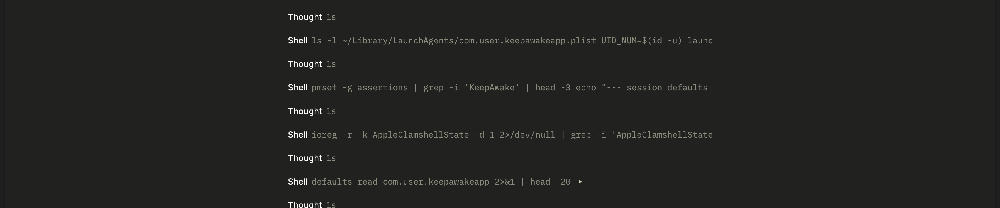
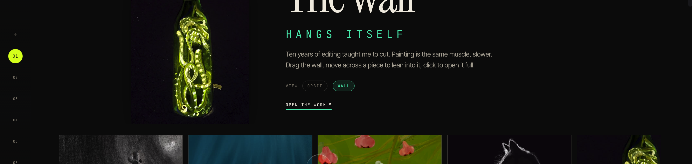

# Switch Everywhere

*formerly KeepAwake — same app, new name as of v2.0.0*

[](LICENSE)
[](https://www.apple.com/macos/)
[](https://swift.org)
[](https://github.com/Blprk/KeepAwake/releases)
[](https://github.com/Blprk/KeepAwake/stargazers)

A tiny, native macOS menu-bar app that keeps your Mac awake — **only when you want it to**. No `caffeinate` subprocess, no sudo, no bloat. ~175 KB binary. The popup header shows a compact **pill toggle** next to the app name for instant on/off.



## Why

`caffeinate` works, but it dies when its shell session ends, it can't tell you its state, and it keeps fighting sleep even with the lid closed (hello, hot backpack). KeepAwake fixes all three:

- 🟢 **Clear on/off state** in the menu bar — `● ON` / `○ OFF` / `⏸` (paused, lid closed)
- 🔒 **Native IOPM assertions** held directly by the app — no subprocess, no `sudo`
- 📱 **Auto-pauses when the lid closes**, auto-resumes when you reopen
- 📊 **Live stats popup** — power source, battery, uptime, awake time, recent sleep/wake events
- 🚀 **Launches at login** via a LaunchAgent
- 🧹 **Fully reversible** — one command removes everything

## Features

| Feature | Detail |
|---|---|
| Assertions held | `PreventUserIdleDisplaySleep`, `PreventUserIdleSystemSleep`, `PreventSystemSleep`, `PreventDiskIdle`, `UserIsActive` |
| Session modes | **Indefinitely**, **Minutes**, **Hours**, **Other Time/Until**, **While App is Running**, **While File is Downloading** |
| Lid-close handling | On AC: keeps assertions (clamshell mode, tasks keep running). On battery: pauses assertions and resumes on open |
| Live info shown | State, session condition + exit time, last event, assertion count, power source, battery %, lid state, uptime, session age, download source |
| Auto-launch | `~/Library/LaunchAgents/com.user.keepawakeapp.plist` (`RunAtLoad`) |
| Binary size | ~156 KB (`-Osize`, dead-strip, stripped) |
| Memory | ~a few MB; ~0% CPU (2s lid/session check via `ioreg`) |
| Configurable assertions | Display / System / Disk groups can be turned on or off individually |
| AppleScript | `session is active`, `start session [minutes]`, `end session`, `time remaining` |
| Diagnostics | In-app event log + "Copy Diagnostics" button |
| Custom download folder | Choose any folder via file picker |

## Session modes



Click the menu-bar icon to open the popup. Under **Start New Session:** choose:

- **Indefinitely** — stays on until you end it (default)
- **Minutes** / **Hours** — preset durations (5–60 min, 1–12 hr); ends automatically
- **Other Time/Until** — until 5 PM, 11 PM, midnight, in 30 min, or in 2 hours
- **While App is Running** — pick a running app; session ends when it quits
- **While File is Downloading** — detects active downloads directly from Safari (`Downloads.plist`) and Chromium browsers' `History` DB (Chrome, Brave, Edge, Vivaldi: `downloads.state = 0`), plus a `~/Downloads` folder heuristic (file growth / `.download`, `.crdownload`, `.part`, `.tmp`). Ends ~30 s after all activity stops.

**What happens when you click Start:** the chosen mode and its parameters are saved to `UserDefaults`, the IOPM assertions are engaged, and the session is monitored every 2 s. For timed modes the menu bar shows a live countdown (`● 14m`, `● 1h23m`) and the app ends the session at the deadline. For "While App is Running" it ends when that app quits. For "While Downloading" it ends 30 s after the last detected download activity. Closing the lid always pauses the assertions; reopening resumes them if the session is still active.

Active sessions persist in `UserDefaults` and resume at login (expired timed sessions do not). The menu-bar icon shows `● ON` / a countdown / `⏸` (lid paused) / `○ OFF`, and the popup header shows the remaining time or session condition.

> **Note:** Safari and Chromium download stores are protected by macOS. If KeepAwake can't read them, it falls back to the `~/Downloads` heuristic and the popup shows "grant Full Disk Access for browser events". You can grant it in **System Settings → Privacy & Security → Full Disk Access**.

## Explicit state model



There is one source of truth — `AppState` — with exactly three states and one transition function (`transition(to:event:)`) that owns assertions, persistence, and UI refresh:

| State | Menu bar | Meaning | Exit |
|---|---|---|---|
| `OFF` | `○ OFF` | No session; no assertions held | Start any session |
| `ACTIVE` | `● ON` or countdown | Session running; 5 assertions held | End Session, timer expiry, app quit, downloads idle, or lid close |
| `LID PAUSED` | `⏸` | Session still saved, assertions released because lid is closed | Reopen lid → returns to `ACTIVE` |

The popup states the current state, the session's exit condition ("Ends in 14m", "Ends when Safari quits", "Ends 30s after downloads stop"), the last transition event, and how many assertions are held. No hidden/implicit state flags remain.

## Settings & controls

The popup is a compact **single-column, scrollable panel** (280pt wide, fixed 460pt height) — back to the simpler design. The header has a custom pill toggle next to the app name for instant on/off. Its size is pinned, so toggling never moves the box. Logs use wrapping text and collapse fully with no leftover gaps.

The **Settings** tab includes:

- **Keep display awake** — turns off `PreventUserIdleDisplaySleep` + `UserIsActive`. Disable this to let the screen sleep while the Mac stays awake (e.g. during a download).
- **Keep system awake** — turns off `PreventUserIdleSystemSleep` + `PreventSystemSleep` (the latter is AC-power only).
- **Keep disks awake** — turns off `PreventDiskIdle`.
- **Download folder** — pick any folder instead of `~/Downloads`.
- **Default session** — what "Turn On" starts: Indefinite or Last used (with its previous duration/app).
- **Menu bar** — Countdown (`● 14m`), Dot (`● ON`), or Icon (`⏱`).
- **Login at startup** — enable/disable the LaunchAgent from the popup.
- **Sleep/Wake Log** and **Debug Log** — collapsible checkbox sections. Toggling them only hides/shows rows in place; the popup never rebuilds on a click, so it does not flash.
- **Copy Diagnostics** button puts version, state, session info, assertion groups, power, download source and the last 30 log lines on the clipboard.

Changing assertion groups while a session is active releases and re-acquires only the enabled assertions.

## AppleScript

KeepAwake is scriptable (via `KeepAwake.sdef`):

```applescript
tell application "KeepAwake"
    session is active        -- true / false
    start session            -- indefinite
    start session 15         -- 15 minute timed session
    time remaining           -- seconds (0 for indefinite)
    end session
end tell
```

## Install

### From source

```bash
git clone https://github.com/Blprk/KeepAwake.git
cd KeepAwake
./scripts/build.sh
```

The app is installed to `~/Applications/KeepAwake.app` and registered to launch at login. The menu-bar icon appears immediately.

### Manual (no build script)

```bash
swiftc -Osize -o ~/Applications/KeepAwake.app/Contents/MacOS/KeepAwake src/main.swift \
  -framework Cocoa -framework IOKit -Xlinker -dead_strip
strip -x ~/Applications/KeepAwake.app/Contents/MacOS/KeepAwake
# copy Info.plist into the bundle, then:
launchctl bootstrap gui/$(id -u) ~/Library/LaunchAgents/com.user.keepawakeapp.plist
```

## Usage

- **Left-click** the menu-bar icon → compact popup with stats + buttons
- **Right-click** → quick menu (Turn On/Off, Refresh, Quit)
- **Turn Off** → releases all assertions; Mac can sleep normally
- **Turn On** → re-engages assertions
- Close the lid → auto-pauses (icon `⏸`); reopen → auto-resumes (if you had it on)

### Verify it's working

```bash
pmset -g assertions | grep KeepAwake
```

You should see 5 lines owned by the app. To confirm sleep prevention, leave the Mac idle for 5 minutes with the lid open — it should not sleep:

```bash
pmset -g log | grep -i "Entering Sleep" | tail -3
```

## Uninstall

```bash
launchctl bootout gui/$(id -u)/com.user.keepawakeapp
rm ~/Library/LaunchAgents/com.user.keepawakeapp.plist
rm -rf ~/Applications/KeepAwake.app
```

No sudo, no system files touched.

## Safety

- **No `sudo`, no system files.** Everything lives in your home directory.
- **Assertions are OS-managed.** If the app crashes or is force-quit, the kernel releases them — your Mac can never get stuck awake.
- **User-initiated sleep still works** (Apple menu → Sleep, closing the lid on battery, low-battery/thermal emergency sleep).
- **Auto-pauses on lid close** to avoid overheating in a bag.
- **No network, no telemetry, no background polling** beyond a 2s lid-state check via `ioreg`.

The only "risk" is battery life: leaving it ON with the lid open drains the battery like normal active use. Toggle Off or close the lid when you don't need it awake.

## Requirements

- macOS 11 (Big Sur) or later
- Xcode Command Line Tools (`xcode-select --install`)

## Code notes

The implementation is a single well-sectioned Swift file (`src/main.swift`) with explicit `// MARK:` groups:

- **Models** — `SessionMode`, `AppState`, `MenuBarStyle`, `SleepEvent`, `Preferences`
- **Lifecycle** — single-instance guard, preference/session loading, AppleEvent registration
- **State machine** — `transition(to:event:)` is the only place assertions, persistence and UI change together
- **Assertions** — individually configurable groups (display / system / disk)
- **Monitoring** — 2s tick for lid + session checks; menu bar and popup labels update **in place** (no view rebuild, no flicker)
- **Downloads** — Safari/Chromium store readers plus folder heuristic, with explicit return values
- **UI** — popover construction with in-place label references and hide/show collapsible sections
- **AppleScript** — four event handlers registered via `NSAppleEventManager`

Everything is documented in-code; no generated code, no dependencies beyond Cocoa + IOKit.

## Project layout

```
KeepAwake/
├── src/main.swift          # the entire app (~350 lines, Swift + Cocoa + IOKit)
├── scripts/build.sh        # build + install
├── Info.plist              # bundle metadata
├── assets/screenshot.png   # menu-bar popup screenshot
├── LICENSE                 # MIT
└── README.md
```

## License

[MIT](LICENSE) © 2026 [Blprk](https://github.com/Blprk)

## Contributing

Issues and PRs welcome. The whole app is a single Swift file — easy to read, easy to hack.
