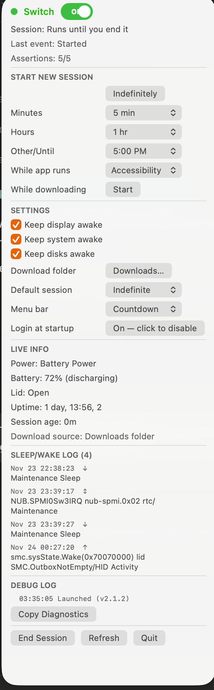

# Switch

[](LICENSE)
[](https://www.apple.com/macos/)
[](https://swift.org)
[](https://github.com/Blprk/switch/releases)
[](https://github.com/Blprk/switch/stargazers)

A tiny native macOS menu-bar app that keeps your Mac awake — only when you want it to. No `caffeinate` subprocess, no `sudo`, no bloat. It is installed as **Switch Everywhere**; the menu bar and popup show the short name **Switch**.




## Why

`caffeinate` dies when its shell session ends, can't tell you its state, and keeps fighting sleep with the lid closed. Switch fixes all three:

- 🟢 **Clear on/off state** — fixed-width menu bar indicator plus a real pill toggle in the popup
- 🔒 **Native IOPM assertions** held directly by the app — no subprocess, no `sudo`
- 💻 **Lid close on AC keeps working** (clamshell); on battery it pauses and resumes when reopened
- 🕐 **Six session modes** — indefinite, minutes, hours, until a time, while an app runs, while files download
- 🧹 **Fully reversible** — three commands remove everything

## Features

| Feature | Detail |
|---|---|
| Core | `PreventUserIdleDisplaySleep`, `PreventUserIdleSystemSleep`, `PreventSystemSleep`, `PreventDiskIdle`, `UserIsActive` |
| Configurable groups | Display / System / Disk assertions can be toggled independently |
| Sessions | Indefinite, Minutes, Hours, Other/Until, While App Running, While Downloading |
| Downloads | Safari `Downloads.plist`, Chromium `History` DB state=0, plus folder heuristic |
| AppleScript | `session is active`, `start session [minutes]`, `end session`, `time remaining` |
| Diagnostics | Event log + "Copy Diagnostics" button |
| Login | Enable/disable LaunchAgent from popup |
| Size | ~175 KB (`-Osize`, dead-strip, stripped) |

## Install

```bash
git clone https://github.com/Blprk/switch.git
cd switch
./scripts/build.sh
```

The app is installed to `~/Applications/Switch Everywhere.app` and registered to launch at login.

### Manual

```bash
swiftc -Osize -o "$HOME/Applications/Switch Everywhere.app/Contents/MacOS/SwitchEverywhere" \
  src/main.swift -framework Cocoa -framework IOKit -Xlinker -dead_strip
cp Info.plist "$HOME/Applications/Switch Everywhere.app/Contents/Info.plist"
cp SwitchEverywhere.sdef "$HOME/Applications/Switch Everywhere.app/Contents/Resources/SwitchEverywhere.sdef"
launchctl bootstrap gui/$(id -u) "$HOME/Library/LaunchAgents/com.user.keepawakeapp.plist"
```

## Usage

- Click the menu bar indicator to open the popup
- Click the **pill toggle** next to **Switch** for instant on/off
- Pick a session under **Start New Session**
- **Settings** controls assertion groups, download folder, default session, menu bar style, and login
- **Live info**, **Sleep/Wake Log**, and **Debug Log** are always visible with wrapping text

### AppleScript

```applescript
tell application "Switch Everywhere"
    session is active
    start session 15
    time remaining
    end session
end tell
```

### Verify

```bash
pmset -g assertions | grep "Switch Everywhere"
launchctl print gui/$(id -u)/com.user.keepawakeapp | grep 'job state'
```

## Uninstall

```bash
launchctl bootout gui/$(id -u)/com.user.keepawakeapp
rm ~/Library/LaunchAgents/com.user.keepawakeapp.plist
rm -rf "$HOME/Applications/Switch Everywhere.app"
```

## Safety

No `sudo`, no system files, no `pmset` changes, no network, no telemetry. Assertions are released by the kernel if the app dies. User-initiated and low-battery sleep still work. On battery, closing the lid pauses assertions; on AC, the Mac can run in clamshell mode.

## Code notes

Single `src/main.swift` with `// MARK:` sections: Models, Lifecycle, State machine, Assertions, Monitoring, Downloads, UI, AppleScript, Stats. All transitions go through `transition(to:event:)`; the menu-bar status item is fixed-width so the popover never shifts when toggled; the popover size is pinned so content is never clipped.

## License

[MIT](LICENSE) © 2026 [Blprk](https://github.com/Blprk)

The GitHub repository is named **switch**; the installed application is **Switch Everywhere**, shown as **Switch** in the UI.
